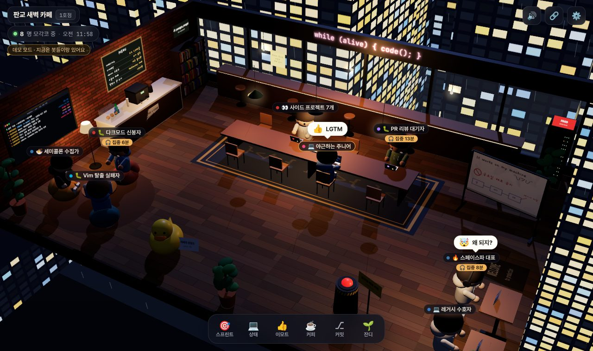
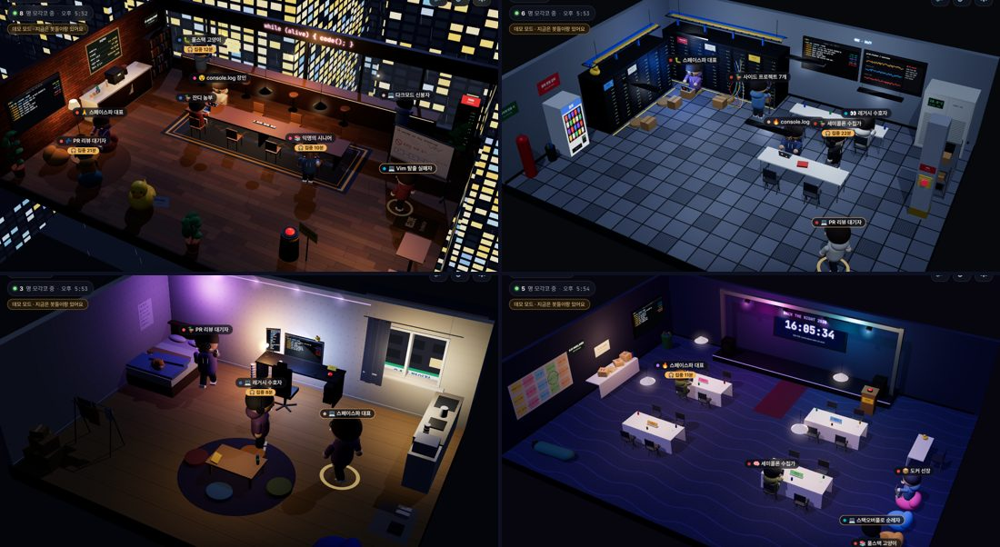
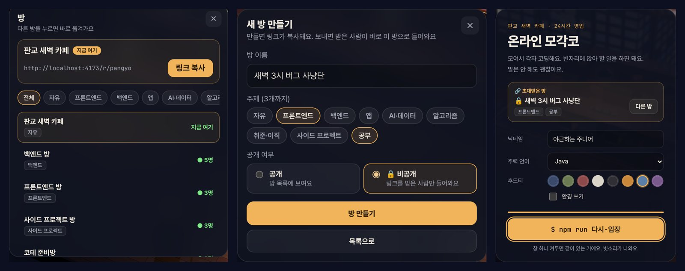

# 온라인 모각코

> 혼자 하면 야근, 같이 하면 모각코

**👉 [code-alone-together.vercel.app](https://code-alone-together.vercel.app)**

모여서 각자 코딩하는 3D 웹 공간이에요. 판교 어딘가 밤새 불이 안 꺼지는 카페, 18°C 서버실, 새벽 2시 원룸, 마감 직전 해커톤장 중에 골라 앉아서 같이 코딩해요. 말은 안 해도 괜찮아요.

"말없이 같이 있기" 장르를 개발자 버전으로 만들었어요. 설치도 회원가입도 없이, 닉네임만 정하면 바로 들어와요. 탭 하나 켜두면 같이 있는 거예요.

스터디나 팀끼리 쓰고 싶으면 방을 하나 만들어서 링크를 보내면 돼요. 받은 사람은 링크를 누르는 순간 그 방으로 들어와요.

> 지금은 사용자 테스트 중이에요. 개인 프로젝트라 무료 서버로 운영하고 있어서, 사람이 한꺼번에 몰리면 연결이 끊기거나 다른 사람이 잠깐 안 보일 수 있어요. 그럴 땐 새로고침 한 번 부탁드려요.

---

## 조작법

| 하고 싶은 것       | 방법                                                                                   |
| ------------------ | -------------------------------------------------------------------------------------- |
| 걷기               | 바닥을 클릭(탭)                                                                        |
| 앉기               | 빈 의자·스툴·빈백·방석·침대·스탠딩 데스크를 클릭. 걸어가서 앉고 노트북을 펴요          |
| 둘러보기           | 드래그로 회전, 휠이나 핀치로 확대·축소                                                 |
| 시점 되돌리기      | 하단 **🎯 시점**. 평소엔 내 캐릭터를 따라 보고, 시점을 옮긴 뒤엔 방 전체로 돌아와요     |
| 한마디 하기        | 하단 **💬**이나 `Enter`. 머리 위 말풍선으로 떠요                                       |
| 꾸미기             | 하단 **👕 꾸미기**                                                                     |
| 다른 사람 보기     | 아바타를 클릭하면 상태, 주력 언어, 몇 분째 있는지, 오늘 몇 잔(몇 개) 먹었는지가 보여요 |
| 사람 목록          | 왼쪽 위 "N명 모각코 중"을 클릭                                                         |
| 방 옮기기 · 만들기 | 왼쪽 위 방 이름이나 하단 **🚪 방**                                                     |
| 친구 초대          | 오른쪽 위 **🔗**로 지금 방 링크를 복사해서 보내기                                      |
| 창 닫기            | `Esc`                                                                                  |

앉아 있을 때 진짜 키보드를 치면 아바타도 열심히 치고 타자 소리가 나요. 몇 번 눌렀는지만 반응하고, 무슨 키를 눌렀는지는 보지 않아요.

## 장소 네 곳

방마다 장소가 하나 정해져 있어요. 다른 장소의 방으로 옮기면 3D 공간이 통째로 바뀌어요. 배경 소리, 먹고 마시는 것, 배포 버튼도 장소마다 달라요.

| 장소              | 분위기                                                         | 정원 | 하단 버튼   | 배포 버튼                                   |
| ----------------- | -------------------------------------------------------------- | ---- | ----------- | ------------------------------------------- |
| ☕ 판교 새벽 카페 | 통창 너머 판교의 등대, 긴 테이블, 창가 바. 빗소리              | 20명 | 커피        | 금요일 배포 버튼                            |
| 🖥️ 서버실         | 18°C, 랙 앞 바닥에 앉기, NOC 모니터링 벽, 크래시 카트. 팬 소리 | 12명 | 자판기 음료 | EPO(비상 전원 차단). 누르면 형광등이 꺼져요 |
| 🛏️ 새벽 2시 원룸  | 모니터 불빛, 침대, 좌식 테이블, 식빵 굽는 고양이               | 8명  | 컵라면      | 책상 위 USB 빨간 버튼                       |
| 🏆 해커톤장       | 팀 테이블 4개, 피자 탑, 데모까지 남은 시간 전광판. 웅성임      | 20명 | 피자        | 최종 제출 단상                              |

기본 방은 카페(판교 새벽 카페, 프론트엔드 방), 서버실(백엔드 방), 원룸(코테 준비방), 해커톤장(사이드 프로젝트 방)에 있어요.

## 방 고르기 · 만들기 · 링크로 초대

1. 하단 **🚪 방** → **새 방 만들기**에서 이름, 장소, 주제를 정해요.
2. 만들면 그 방으로 옮겨가고 링크가 클립보드에 복사돼요. 나중에 다시 복사하려면 오른쪽 위 **🔗**를 눌러요.
3. 카톡이나 슬랙에 링크를 붙여넣어요. 받은 사람은 입장 화면에서 "🔗 초대받은 방"을 보고 바로 들어와요.

- 방 목록에서 주제 칩으로 원하는 방만 골라 볼 수 있어요. 지금 몇 명 있는지도 떠요.
- 한 방에 장소 정원보다 많이 오면 늦게 온 사람은 같은 방 2호점으로 나뉘어요.
- 방은 30초에 하나씩 만들 수 있어요.

## 접속 시간

- 위쪽 인원 표시 옆에 `⏱ 23분`처럼 이 방에 들어온 뒤 지난 시간이 떠요. 방을 옮기면 다시 0부터 세요.
- 다른 사람을 누르면 그 사람이 얼마나 있었는지도 볼 수 있어요.

## 상태와 이모트

머리 위 이름표에 지금 하는 일이 이모지로 떠요.

> 💻 코딩 중 · 🐛 버그 잡는 중 · 🔥 핫픽스 중 · 👀 코드리뷰 중 · 📚 공부 중 · 🧠 설계 고민 중 · 🦆 오리랑 대화 중 · 📦 배포 기다리는 중 · 🙏 빌드 기도 중 · 😵 야근 중 · 🍜 밥 먹는 중 · 💤 자리 비움

말 대신 이모트로 반응해요. 말풍선으로 잠깐 떠요.

> 👍 LGTM · 🔥 불났다 · 🎉 배포 성공 · 🙏 제발 돼라 · 🤯 왜 되지? · 😇 왜 안 되지? · ☕ 커피 수혈 · 👋 안녕하세요

큰 동작도 있어요. 이모트 시트 아래쪽에서 골라요.

> 💃 춤추기 · 💥 노트북 던지기 · 💢 책상 뒤집기 · 😵 번아웃 기절

다른 사람 아바타를 눌러서 **👋 손 흔들기**를 하면 상대방 화면에 알림이 가요.

## 채팅

하단 **💬**이나 `Enter`로 한마디를 보내요. 머리 위 말풍선으로 잠깐 뜨고, 최근 대화는 채팅 창에 쌓여요.

- 한 번에 50자까지, 1.5초에 한 번씩 보낼 수 있어요.
- 욕설은 가려지고, 욕설이 든 메시지는 보낼 수 없어요.
- 채팅은 같은 방 사람들에게 전달만 하고 저장하지 않아요. 방을 옮기거나 새로고침하면 사라져요.
- 남기고 싶은 말은 줄 옆 **📌**을 누르면 커밋 방명록에 `chore`로 올라가요.

## 꾸미기

하단 **👕 꾸미기**에서 내 캐릭터를 바꿔요. 3D 미리보기를 끌어서 돌려 볼 수 있고, 춤추기 같은 동작도 입은 채로 미리 볼 수 있어요.

- 머리(단정·똥머리·포니테일·양갈래·긴 머리·뾰족·아프로), 모자(비니·볼캡·고양이 귀·프로펠러·왕관·러버덕·천사 고리)
- 등(백팩·망토·날개·거북 등딱지), 목(목도리·사원증·나비넥타이·목 헤드폰), 색, 안경
- 🎲 랜덤과 ↺ 기본 옷도 있어요.

## 커밋 방명록

하단 **⎇ 커밋**이나 git log 화면(카페·해커톤장은 벽 TV, 서버실은 모니터링 벽, 원룸은 책상 모니터)을 누르면 `git commit -m "feat: ..."` 형식으로 한 줄을 남길 수 있어요. 남긴 커밋은 그 방 `git log --oneline --graph` 화면에 올라가고, 방에 있는 모두에게 알림이 가요.

- 30초에 한 번씩 남길 수 있어요.
- 욕설은 가려지고, 욕설이 든 메시지는 남길 수 없어요.
- 방에 들어온 누구나 볼 수 있으니 실명이나 연락처는 적지 마세요.

## 카페 곳곳의 밈

| 장소 / 물건             | 누르면                                                                                                                                                |
| ----------------------- | ----------------------------------------------------------------------------------------------------------------------------------------------------- |
| 🚨 **금요일 배포 버튼** | 확인창에서 "배포한다"를 고르면 걸어가서 버튼을 눌러요. 방 전체에 빨간 경보와 사이렌이 울리고, 모두가 🔥🤯 반응을 해요. 7초 뒤 "롤백 완료". 1분 쿨타임 |
| ☕ **커피 카운터**      | 걸어가서 커피를 내려 마셔요. "아메리카노 = 코드 1,000줄". 5잔째부터는 물도 마시라고 해요                                                              |
| 🦆 **러버덕 상담소**    | 오리가 꽥 하고 디버깅 질문을 던져요. "캐시 지워봤어?", "타임존 문제야. 항상 타임존이야."                                                              |
| 📺 **git log TV**       | 커밋 방명록이 열려요                                                                                                                                  |
| 화이트보드              | 앞면 "It works on my machine ¯\\\_(ツ)\_/¯", 금요일 배포 금지. 뒷면 TODO (리팩토링은 2080년부터 예정)                                                 |
| 서버랙                  | prod 서버. 만지지 마시오. 평소엔 초록 LED, 장애 나면 빨갛게 깜빡여요                                                                                  |
| 메뉴판                  | 아메리카노, 디카페인(의미 없음), 오늘의 라떼: NullPointer 라떼                                                                                        |
| 판교 사투리 사전        | 얼라인 = 맞춰보자, 싱크 = 회의하자, ASAP = 어제까지, R&R = 네 일                                                                                      |
| 벽시계 두 개            | KST와 UTC. "서버는 UTC, 타임존 버그 주의"                                                                                                             |
| 창밖                    | 새벽에도 불이 다 켜진 오피스, 일명 "판교의 등대". 비가 와요                                                                                           |
| 그 밖에                 | 와이파이 비번 `1q2w3e4r!`, 테이블 위 멀티탭, 노트북 스티커 색은 주력 언어 색, 문 앞 매트 "WELCOME to production"                                      |

## 다른 장소의 밈

| 장소             | 눌러볼 것                                                                                                                                                                                                          |
| ---------------- | ------------------------------------------------------------------------------------------------------------------------------------------------------------------------------------------------------------------ |
| 🖥️ 서버실        | 랙 라벨(legacy-01, DO NOT REBOOT, 이름만 k8s, 사실 prod), 쏟아진 케이블 스파게티, 항상 18°C인 항온항습기, 서버실 음료 반입 금지 바로 옆 자판기, 장애 대응 매뉴얼 v1.0 (2017), 37개짜리 알림 대시보드, 랙 위 러버덕 |
| 🛏️ 새벽 2시 원룸 | 고양이(야옹), 지금 자면 몇 시간 잘 수 있는지 알려주는 알람시계, 컵라면 탑, 3일째 마르는 빨래, 안 뜯은 택배, "일찍 자기"에 줄 그은 할 일 포스터, 창밖 24시 편의점                                                   |
| 🏆 해커톤장      | 팀 텐트 카드(아이디어만 47개, 노코드로 다 함, 일단 블록체인, 잠은 데모 후에), 아이디어 벽, 멘토 데스크와 러버덕, 침낭에서 자는 참가자, npm install이 안 끝나는 와이파이                                            |

## 같이 있다는 느낌

- 지금 몇 명이 있는지, 누가 들어오고 "퇴근"했는지 알려줘요.
- 새로 온 사람은 문에서 걸어 들어오고, 자리를 옮기면 의자까지 걸어가요.
- 앉아 있는 사람 수만큼 멀리서 키보드 소리가 들려요.
- 장소마다 배경 소리가 달라요. 카페는 빗소리와 웅성임, 서버실은 팬 소리, 원룸은 조용한 빗소리, 해커톤장은 사람들 소리. 오른쪽 위 🔊로 끌 수 있어요.

## 내 기록은 어디에 남나요

| 정보                                                     | 어디에                                                                          |
| -------------------------------------------------------- | ------------------------------------------------------------------------------- |
| 닉네임, 외형(옷·머리·모자·안경 등), 주력 언어, 소리 설정  | 내 브라우저에만. 다른 기기나 시크릿 창에서는 처음부터 시작해요                  |
| 닉네임, 외형, 상태, 앉은 자리, 채팅                      | 같은 방 사람들에게 실시간으로만 전달하고 저장하지 않아요                       |
| 커밋 방명록 (닉네임, 메시지, 주력 언어, 시각)            | 서버에 저장되고 그 방에 들어온 누구나 볼 수 있어요                              |
| 키보드 입력 내용                                         | 수집하지 않아요                                                                 |

자세한 내용은 [개인정보 처리방침](https://code-alone-together.vercel.app/privacy.html)에 있어요.

## 피드백

써보고 불편한 점이나 버그가 있으면 사이트 아래 **피드백 보내기**나 [code_alone_together@naver.com](mailto:code_alone_together@naver.com)으로 알려주세요. 버벅이거나 안 열리는 기기가 있다면 기종과 브라우저도 같이 적어주시면 큰 도움이 돼요.

## 토스 앱(앱인토스)

토스 앱 안에서 열리는 미니앱 버전은 `toss-appinToss` 브랜치에 있어요. 웹과 같은 코드에 앱인토스 설정과 토스 전용 처리를 얹었어요.

- 앱 이름(`appName`)은 `code-alone-together`예요. 설정은 `apps-in-toss.config.ts`에 있어요.
- **방 주소**: `intoss://code-alone-together?room=<방 주소>`로 열면 그 방으로 바로 들어와요(예: `?room=pangyo`).
- **공유**: 오른쪽 위 🔗과 방 시트의 링크 복사가 토스 공유 시트(링크 포함)를 열어요. 코드는 `src/toss.ts`에 있어요.
- **개인정보 처리방침**: 새 창으로 나가지 않고 앱 안 시트로 열려요. 토스용 문서는 `public/privacy-toss.html`이에요. 웹용 `public/privacy.html`을 고칠 때 같이 확인해요.
- **빌드와 올리기**: `npm run build`가 타입 검사, 웹 빌드, `ait build`를 차례로 돌려서 `code-alone-together.ait`를 만들어요. 올릴 때는 `npm run deploy`(`ait deploy`)나 앱인토스 콘솔을 써요.
